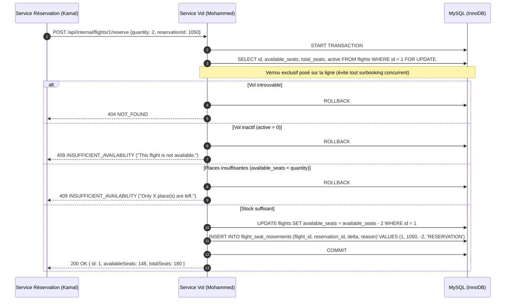

# Dossier des Spécifications Fonctionnelles Détaillées (SFD)

**Projet :** Online Travel Agency (Atlas Trips) — Service de Gestion des Vols  
**Responsable du module :** Mohammed  
**Branche Git dédiée :** `mohammed`  
**Composant / Service :** `flight-service` (Port HTTP `8081`)  
**Date :** 13/11/2026  
**Statut :** Validé  

---

## Historique du document

| Version | Auteur | Date | Nature des modifications | Validation |
| :---: | :---: | :---: | :--- | :---: |
| **0.1** | Mohammed | 13/11/2026 | Initialisation du dossier, cadrage du périmètre du service de vol | À valider |
| **0.2** | Mohammed | 13/11/2026 | Spécification des écrans utilisateur et formulaires d'administration | À valider |
| **0.3** | Mohammed | 13/11/2026 | Spécification détaillée des flux inter-services (réservation et libération) | À valider |
| **1.0** | Mohammed | 13/11/2026 | Intégration des contraintes non fonctionnelles et validation finale | Validé |

---

## Table des matières

1. [Introduction](#1-introduction)  
   1.1. [Objectif du document](#11-objectif-du-document)  
   1.2. [Portée du système](#12-portée-du-système)  
   1.3. [Définitions & Lexique](#13-définitions--lexique)  
2. [Fonctionnalités générales](#2-fonctionnalités-générales)  
3. [Description fonctionnelle détaillée](#3-description-fonctionnelle-détaillée)  
   3.1. [F001 — Consultation et recherche multicritère des vols](#31-f001--consultation-et-recherche-multicritère-des-vols)  
   3.2. [F002 — Fiche détail d'un vol et sélection de places](#32-f002--fiche-détail-dun-vol-et-sélection-de-places)  
   3.3. [F003 — Création d'un vol (Administration)](#33-f003--création-dun-vol-administration)  
   3.4. [F004 — Gestion, modification et suppression des vols (Administration)](#34-f004--gestion-modification-et-suppression-des-vols-administration)  
   3.5. [F005 — Vérification de disponibilité des sièges](#35-f005--vérification-de-disponibilité-des-sièges)  
   3.6. [F006 — Réservation atomique de places (Inter-service)](#36-f006--réservation-atomique-de-places-inter-service)  
   3.7. [F007 — Libération de places suite à annulation (Inter-service)](#37-f007--libération-de-places-suite-à-annulation-inter-service)  
   3.8. [F008 — Journalisation et traçabilité des mouvements de capacité](#38-f008--journalisation-et-traçabilité-des-mouvements-de-capacité)  
4. [Contraintes non fonctionnelles](#4-contraintes-non-fonctionnelles)  
   4.1. [Ergonomie & Compatibilité navigateurs](#41-ergonomie--compatibilité-navigateurs)  
   4.2. [Performance & Temps de réponse](#42-performance--temps-de-réponse)  
   4.3. [Sécurité & Confidentialité](#43-sécurité--confidentialité)  
   4.4. [Fiabilité & Concurrence (Transactions ACID)](#44-fiabilité--concurrence-transactions-acid)  
   4.5. [Disponibilité & Conteneurisation](#45-disponibilité--conteneurisation)  

---

## 1. Introduction

### 1.1. Objectif du document
Ce document constitue la référence fonctionnelle exhaustive du **Service de Gestion des Vols** au sein de la plateforme e-commerce et touristique **Atlas Trips**.  
Il a pour but de :
* Définir avec précision le comportement attendu de chaque fonctionnalité utilisateur, administrateur et inter-service.
* Décrire les règles de gestion métier régissant l'entité `Flight` et son stock de places.
* Servir de passerelle contractuelle entre les développements backend (Node.js/Express de Mohammed), le frontend Angular et les microservices partenaires (Réservations de Kamal, Packages de Youssef).
* Encadrer la recette fonctionnelle et la conception des scénarios de test.

### 1.2. Portée du système
Le système couvert par ce document est le **Service de Gestion des Vols (`flight-service`)**, hébergé sur le port **8081**, possédant et administrant ses propres tables MySQL (`flights` et `flight_seat_movements`).  
Il englobe :
1. Le catalogue public de vols consultable par les clients de l'agence.
2. Le moteur de recherche et de filtrage dynamique (villes, dates, budget, places).
3. L'espace d'administration sécurisé pour la gestion du cycle de vie des vols.
4. L'API d'inventaire interne répondant aux réservations et annulations transactionnelles.

### 1.3. Définitions & Lexique

| Terme | Définition |
| :--- | :--- |
| **Vol (`Flight`)** | Entité représentant une liaison aérienne commerciale opérée par une compagnie entre deux villes à des dates/heures définies. |
| **Numéro de vol (`flightNumber`)** | Identifiant alphanumérique attribué par la compagnie (ex: `RAM101`, `AF1714`). La paire `(flightNumber, departureTime)` est unique. |
| **Capacité totale (`totalSeats`)** | Nombre maximal de passagers que l'aéronef peut accueillir pour ce trajet. |
| **Places disponibles (`availableSeats`)** | Sièges encore libres à la vente à l'instant T (`0 <= availableSeats <= totalSeats`). |
| **Mouvement de capacité (`seat movement`)** | Événement horodaté consignant toute variation du stock de places (décrémentation lors d'une réservation, incrémentation lors d'une libération). |
| **Client** | Utilisateur final naviguant sur l'application web pour consulter ou réserver un vol. |
| **Administrateur (`ADMIN`)** | Utilisateur habilité via un jeton JWT porteur du rôle `ADMIN` pour créer, éditer ou supprimer des vols. |
| **Service Réservation** | Microservice tiers (développé par Kamal sur le port 8085) orchestrant les paniers, réservations et paiements. |

---

## 2. Fonctionnalités générales

| ID | Nom de la fonctionnalité | Priorité | Description |
| :---: | :--- | :---: | :--- |
| **F001** | Consultation et recherche multicritère des vols | **Haute** | Affichage du catalogue sous forme de cartes avec filtres combinés (villes, date, prix, quantité). |
| **F002** | Fiche détail d'un vol | **Haute** | Visualisation détaillée des horaires, durée, appareil, tarif et sélection du nombre de passagers. |
| **F003** | Création d'un vol (Admin) | **Haute** | Formulaire d'ajout d'un vol avec contrôle strict des contraintes d'intégrité et règles métier. |
| **F004** | Modification et suppression d'un vol (Admin) | **Haute** | Mise à jour des informations d'un vol ou suppression avec fenêtre de confirmation modale. |
| **F005** | Vérification de la disponibilité des sièges | **Haute** | Endpoint public fournissant le stock restant et la capacité totale d'un vol. |
| **F006** | Réservation atomique de places | **Critique** | Décrémentation transactionnelle du stock de places avec verrouillage exclusif `SELECT ... FOR UPDATE`. |
| **F007** | Libération de places (Annulation / Refus paiement) | **Critique** | Réintégration transactionnelle des places libérées, plafonnées à la capacité totale. |
| **F008** | Journalisation des mouvements de stock | **Moyenne** | Audit de chaque opération de stock dans la table `flight_seat_movements`. |
| **F009** | Sonde de surveillance et de santé (`Healthcheck`) | **Basse** | Endpoint technique `/health` indiquant la disponibilité du service. |

---

## 3. Description fonctionnelle détaillée

### 3.1. F001 — Consultation et recherche multicritère des vols

#### Description
Permet à tout voyageur (authentifié ou non) d'accéder à la liste des vols programmés et de filtrer les résultats selon ses critères de voyage.

```
+-----------------------------------------------------------------------------------------+
|  Atlas Trips  -  Vols                                                                   |
|  Choisissez votre vol et réservez votre siège en quelques clics.                        |
+-----------------------------------------------------------------------------------------+
| [ Ville départ: Casablanca ] [ Ville arrivée: Paris ] [ Date: 2026-06-01 ] [ Prix max ] |
| [ Places: 2                 ] [ Bouton: Filtrer    ] [ Bouton: Réinitialiser           ] |
+-----------------------------------------------------------------------------------------+
| +----------------------------------+  +----------------------------------+              |
| | [Image: Avion]                   |  | [Image: Avion]                   |              |
| | Royal Air Maroc - RAM101         |  | Air France - AF1714              |              |
| | Casablanca  ------>  Paris       |  | Paris  ------>  Istanbul         |              |
| | Départ: 01/06/2026 à 08:00       |  | Départ: 12/07/2026 à 14:00       |              |
| | 150 places restantes             |  | 95 places restantes              |              |
| | Prix : 2 450 MAD                 |  | Prix : 1 980 MAD                 |              |
| | [ Bouton: Réserver ]             |  | [ Bouton: Réserver ]             |              |
| +----------------------------------+  +----------------------------------+              |
+-----------------------------------------------------------------------------------------+
```

#### 3.1.1 Composantes de l'interface

| Entrée / Composant | Type | Règles de gestion | Remarques |
| :--- | :--- | :--- | :--- |
| `departureCity` | Champ texte | Recherche insensible à la casse (`LIKE %valeur%`). | Ex: "Casablanca" |
| `arrivalCity` | Champ texte | Recherche insensible à la casse (`LIKE %valeur%`). | Ex: "Paris" |
| `departureDate` | Sélecteur date | Format `YYYY-MM-DD`. Compare le début de `departure_time`. | Filtre sur la journée |
| `maxPrice` | Champ numérique | Montant `>= 0`. Filtre les vols dont `price <= maxPrice`. | Optionnel |
| `quantity` / `minSeats` | Champ numérique | Entier `>= 1`. Filtre les vols dont `available_seats >= quantity`. | Par défaut: 1 place |
| `search` | Champ texte | Recherche globale sur compagnie, numéro, ville départ ou arrivée. | Utilisé dans l'admin |
| `cards` | Grille de cartes | Affiche l'image, le badge de disponibilité, les villes et le tarif. | Éléments cliquables |

#### 3.1.2 Actions & Traitements

| Action / Événement | Type | Règles de gestion & Traitement | Résultat attendu |
| :--- | :--- | :--- | :--- |
| **Chargement initial** | Requête HTTP `GET` | Appel à `GET /api/flights` avec paramètres par défaut. Tri par `departure_time ASC`. | Liste des vols actifs affichée. |
| **Soumission des filtres** | Clic bouton "Filtrer" | Récupération des valeurs non vides, construction de la QueryString et rechargement. | Affichage des vols correspondant aux critères. |
| **Réinitialisation** | Clic bouton "Reset" | Effacement des filtres de recherche et rechargement de la liste par défaut. | Affichage de l'ensemble du catalogue. |
| **Clic sur une carte** | Événement utilisateur | Redirection vers la route `/flights/:id` pour consulter la fiche complète. | Affichage de l'écran F002. |

---

### 3.2. F002 — Fiche détail d'un vol et sélection de places

#### Description
Présente toutes les caractéristiques d'un vol spécifique (horaires détaillés, aéroport, durée estimée, places disponibles) et permet d'initier la réservation d'un nombre déterminé de sièges.

```
+-----------------------------------------------------------------------------------------+
| Accueil > Vols > Casablanca - Paris                                                     |
+-----------------------------------------------------------------------------------------+
| [ Image Grand Format du Vol ]                                                           |
|                                                                                         |
| Royal Air Maroc  -  Vol RAM101                                 [ Badge : Disponible ]   |
| Trajet : Casablanca  ------->  Paris                                                    |
|                                                                                         |
|  * Heure de départ :  01/06/2026 à 08:00                                                |
|  * Heure d'arrivée :  01/06/2026 à 11:00                                                |
|  * Durée estimée   :  3h 00min                                                          |
|  * Places totales  :  180                                                               |
|  * Places libres   :  150                                                               |
|  * Tarif unitaire  :  2 450 MAD par passager                                            |
|                                                                                         |
| Nombre de passagers : [ - ]  2  [ + ]   (Maximum : 150)                                 |
| Montant total : 4 900 MAD                                                               |
|                                                                                         |
| [ Bouton : Réserver ce vol ]                                                            |
+-----------------------------------------------------------------------------------------+
```

#### 3.2.1 Composantes de l'interface

| Entrée / Composant | Type | Règles de gestion | Remarques |
| :--- | :--- | :--- | :--- |
| `id` | Paramètre d'URL | Entier strictement positif. Identifiant du vol. | Erreur 404 si inexistant |
| `quantity` | Sélecteur numérique | Min = 1, Max = `availableSeats`. Incrémentation / décrémentation. | Ne peut dépasser le stock |
| `badgeStatus` | Indicateur visuel | "Disponible" (vert), "Complet" (rouge si 0 place), "Expiré" (si date passée). | Calculé automatiquement |
| `totalPrice` | Libellé dynamique | Calculé en temps réel : `quantity * price`. | Devise : MAD |

#### 3.2.2 Actions & Traitements

| Action / Événement | Type | Règles de gestion & Traitement | Résultat attendu |
| :--- | :--- | :--- | :--- |
| **Chargement de la page** | Requête HTTP `GET` | Appel à `GET /api/flights/:id`. Renvoie `404` si l'identifiant n'existe pas. | Fiche affichée ou message d'erreur. |
| **Modification quantité** | Boutons `+` / `-` | Ajuste `quantity` entre 1 et `availableSeats`. Recalcule le prix total affiché. | Montant total mis à jour. |
| **Clic sur Réserver** | Clic bouton | Si l'utilisateur n'est pas connecté, redirection vers `/sign-in`. Sinon, transmission au service de réservation. | Redirection vers le tunnel d'achat. |

---

### 3.3. F003 — Création d'un vol (Administration)

#### Description
Permet à un administrateur d'enregistrer un nouveau vol dans le catalogue de l'agence avec contrôle temps réel de la conformité des données.

```
+-----------------------------------------------------------------------------------------+
| Espace Administration  -  Nouveau vol                                                   |
| Créer un vol dans le catalogue.                                                         |
+-----------------------------------------------------------------------------------------+
| [ COUVERTURE ]                                                                          |
| URL de l'image : [ imgs/flight-1.jpg                                                  ] |
|                                                                                         |
| [ COMPAGNIE ET IDENTITÉ ]                                                               |
| Compagnie (*) :  [ Royal Air Maroc        ]   Numéro de vol (*) : [ RAM101            ] |
|                                                                                         |
| [ ITINÉRAIRE ]                                                                          |
| Ville de départ (*) : [ Casablanca        ]   Ville d'arrivée (*) : [ Paris           ] |
|                                                                                         |
| [ HORAIRES ]                                                                            |
| Date/heure départ (*) : [ 2026-06-01 08:00]   Date/heure arrivée (*): [2026-06-01 11:00]|
|                                                                                         |
| [ CAPACITÉ & PRIX ]                                                                     |
| Total sièges (*) : [ 180 ]                     Sièges disponibles (*) : [ 150 ]         |
| Prix unitaire (MAD) (*) : [ 2450.00 ]          Statut : [ Bouton Toggle : Actif / Inactif]|
|                                                                                         |
| [ Bouton : Annuler ]                                    [ Bouton : Enregistrer le vol ] |
+-----------------------------------------------------------------------------------------+
```

#### 3.3.1 Composantes du formulaire

| Champ | Type | Règles de gestion | Remarques |
| :--- | :--- | :--- | :--- |
| `airline` | Texte (max 80) | Obligatoire, non vide après suppression des espaces. | Ex: "Royal Air Maroc" |
| `flightNumber` | Texte (max 12) | Obligatoire, non vide. La paire `(flightNumber, departureTime)` doit être unique. | Erreur 409 si doublon |
| `departureCity` | Texte (max 80) | Obligatoire, non vide. | Ex: "Casablanca" |
| `arrivalCity` | Texte (max 80) | Obligatoire, non vide. | Ex: "Paris" |
| `departureTime` | Date / Heure | Format valide ISO ou DATETIME (`YYYY-MM-DD HH:mm:ss`). | Heure par défaut: 08:00 |
| `arrivalTime` | Date / Heure | Obligatoire. **Règle stricte : doit être chronologiquement postérieure à `departureTime`**. | Erreur 422 si arr <= dép |
| `totalSeats` | Entier positif | Obligatoire, entier strictement supérieur à 0. | Ex: 180 |
| `availableSeats` | Entier positif | Obligatoire. **Règle : `0 <= availableSeats <= totalSeats`**. | Erreur 422 si dépassement |
| `price` | Décimal | Obligatoire, nombre positif ou nul (`>= 0.00`), arrondi à 2 décimales. | En dirhams marocains (MAD) |
| `active` | Booléen | Vrai (`1`) si le vol est visible et réservable, Faux (`0`) sinon. | Par défaut: `true` |
| `imageUrl` | Texte (max 255) | Optionnel. Chemin de l'image statique ou URL externe. | Ex: `imgs/flight-1.jpg` |

#### 3.3.2 Actions & Traitements

| Action / Événement | Type | Règles de gestion & Traitement | Résultat attendu |
| :--- | :--- | :--- | :--- |
| **Validation formulaire** | Traitement client | Vérifie que tous les champs obligatoires sont saisis et cohérents avant l'envoi. | Messages d'erreur sous les champs. |
| **Enregistrement (`POST`)**| Requête HTTP | `POST /api/flights` avec en-tête `Authorization: Bearer <token_admin>`. Vérification du rôle `ADMIN`. | Code `201 Created` avec objet créé. |
| **Erreur de doublon** | Exception SQL | Si collision sur la clé unique `uk_flights_number_departure`, retour code `409 CONFLICT`. | Message explicatif à l'utilisateur. |
| **Annulation** | Clic bouton | Abandon des modifications et retour à la table `/admin/flights`. | Redirection sans enregistrement. |

---

### 3.4. F004 — Gestion, modification et suppression des vols (Administration)

#### Description
Fournit à l'administrateur une vue tabulaire de tous les vols du système avec la possibilité de rechercher, filtrer, éditer un vol existant ou le supprimer.

```
+-----------------------------------------------------------------------------------------+
| Espace Administration  -  Vols                                   [ + Nouveau vol ]      |
+-----------------------------------------------------------------------------------------+
| Recherche : [ Compagnie, numéro ou ville...                                           ] |
+-----------------------------------------------------------------------------------------+
| N° Vol | Compagnie        | Itinéraire            | Départ           | Prix     | Actions|
+--------+------------------+-----------------------+------------------+----------+--------+
| RAM101 | Royal Air Maroc  | Casablanca - Paris    | 01/06/2026 08:00 | 2450 MAD | [Edit] |
|        |                  |                       |                  |          | [Suppr]|
+--------+------------------+-----------------------+------------------+----------+--------+
| AF1714 | Air France       | Paris - Istanbul      | 12/07/2026 14:00 | 1980 MAD | [Edit] |
|        |                  |                       |                  |          | [Suppr]|
+-----------------------------------------------------------------------------------------+
| Fenêtre modale de suppression :                                                         |
| "Êtes-vous sûr de vouloir supprimer ce vol ?"                   [ Annuler ] [ Confirmer]|
+-----------------------------------------------------------------------------------------+
```

#### 3.4.1 Composantes de l'interface

| Composant | Type | Rôle / Description |
| :--- | :--- | :--- |
| `Bouton Nouveau Vol` | Bouton primaire | Ouvre le formulaire de création F003 (`/admin/flights/form`). |
| `kz-data-table` | Tableau interactif | Colonnes : Numéro, Compagnie, Trajet, Date départ, Prix, Sièges, Statut, Actions. |
| `Bouton Éditer (Edit)` | Icône / Bouton | Redirige vers `/admin/flights/form/:id` pré-rempli avec les données existantes. |
| `Bouton Supprimer` | Icône / Bouton | Ouvre la boîte de dialogue de confirmation avant suppression effective. |
| `kz-dialog` | Fenêtre modale | Empêche les suppressions accidentelles. |

#### 3.4.2 Actions & Traitements

| Action / Traitement | Type | Règles de gestion & Traitement | Résultat attendu |
| :--- | :--- | :--- | :--- |
| **Modification (`PUT/POST`)**| Requête HTTP | `PUT /api/flights/:id` ou `POST /api/flights/:id` avec jeton admin. Mise à jour de la ligne en base. | Code `200 OK` et retour à la table. |
| **Confirmation suppression** | Requête HTTP `DELETE`| `DELETE /api/flights/:id`. Suppression en cascade des mouvements associés (`ON DELETE CASCADE`). | Ligne retirée du tableau. |
| **Rejet non autorisé** | Contrôle de sécurité | Si le jeton est manquant, expiré ou n'a pas le rôle `ADMIN` : retour `401` ou `403`. | Accès refusé, redirection login. |

---

### 3.5. F005 — Vérification de disponibilité des sièges

#### Description
Fournit à tout client ou service consommateur l'état de l'inventaire des sièges pour un vol donné.

* **Route :** `GET /api/flights/:id/availability`
* **Contrôles :**
  1. Vérifier l'existence du vol par son `id`.
  2. Si le vol n'existe pas : retourner `404 NOT_FOUND`.
  3. Retourner l'enveloppe :
     ```json
     {
       "data": {
         "id": 1,
         "availableSeats": 150,
         "totalSeats": 180,
         "capacity": 180
       }
     }
     ```

---

### 3.6. F006 — Réservation atomique de places (Inter-service)

#### Description
Point d'entrée interne sollicité par le service de Réservation (Kamal) lorsqu'un client valide un panier contenant un vol.

* **Route :** `POST /api/internal/flights/:id/reserve`
* **Corps de la requête :**
  ```json
  {
    "quantity": 2,
    "reservationId": 1050
  }
  ```

#### 3.6.1 Règles de gestion et exécution transactionnelle



---

### 3.7. F007 — Libération de places suite à annulation (Inter-service)

#### Description
Point d'entrée interne sollicité par le service de Réservation (Kamal) lorsqu'un paiement échoue, qu'une réservation expire ou qu'un client annule sa commande.

* **Route :** `POST /api/internal/flights/:id/release`
* **Corps de la requête :**
  ```json
  {
    "quantity": 2,
    "reservationId": 1050
  }
  ```

#### 3.7.1 Règles de gestion & Traitement
1. Démarrer une transaction InnoDB.
2. Poser un verrou exclusif : `SELECT ... FROM flights WHERE id = ? FOR UPDATE`.
3. Calculer le nouveau stock : `nouveauStock = Math.min(total_seats, available_seats + quantity)`.  
   *(Règle absolue : le stock ne peut jamais dépasser la capacité totale de l'appareil).*
4. Mettre à jour la table : `UPDATE flights SET available_seats = nouveauStock WHERE id = ?`.
5. Journaliser le mouvement : `INSERT INTO flight_seat_movements (flight_id, reservation_id, delta, reason) VALUES (?, ?, +quantity, 'RELEASE')`.
6. Valider la transaction (`COMMIT`) et renvoyer le statut `200 OK`.

---

### 3.8. F008 — Journalisation et traçabilité des mouvements de capacité

#### Description
Chaque variation de stock de sièges est automatiquement tracée dans la table `flight_seat_movements`.

* **Données enregistrées :**
  * `flight_id` : référence du vol concerné.
  * `reservation_id` : numéro de réservation associé (ou `NULL` pour un réajustement manuel).
  * `delta` : entier signé (`-N` pour une réservation, `+N` pour une libération).
  * `reason` : motif du mouvement parmi l'énumération (`RESERVATION`, `RELEASE`, `ADMIN`).
  * `created_at` : horodatage automatique de l'événement.

---

## 4. Contraintes non fonctionnelles

### 4.1. Ergonomie & Compatibilité navigateurs
* **Navigateurs cibles :** Google Chrome, Mozilla Firefox, Microsoft Edge, Apple Safari (versions desktop et mobile récentes).
* **Interface responsive :** Adaptation fluide des cartes de vol et des tableaux administratifs sur écrans smartphone, tablette et grand écran desktop.
* **Intégration Angular :** Parfaite conformité aux composants et design system Atlas Trips (`kz-card`, `kz-filter-bar`, `kz-data-table`, `kz-loading`, `kz-error-popup`).

### 4.2. Performance & Temps de réponse
* **Temps de réponse API :** Le temps d'exécution des requêtes de consultation (`GET /api/flights`) doit être **inférieur à 100 ms** en charge nominale.
* **Optimisation des index MySQL :** Utilisation d'index B-Tree composites :
  * `idx_flights_search (departure_city, arrival_city, departure_time)` pour accélérer les filtres de recherche.
  * `idx_flights_price (price)` pour accélérer les tris budgétaires.
  * `uk_flights_number_departure (flight_number, departure_time)` pour l'unicité matérielle.

### 4.3. Sécurité & Confidentialité
* **Authentification & Rôles :** Les opérations de mutation sur le catalogue (`POST`, `PUT`, `DELETE /api/flights`) requièrent obligatoirement un en-tête `Authorization: Bearer <token_jwt>`. Le token doit être signé avec l'algorithme `HS256` et le secret partagé (`JWT_SECRET`), et contenir le rôle `role: "ADMIN"`.
* **Principe d'isolation des données :** Le service de vol n'accède jamais directement aux tables des utilisateurs, réservations ou paiements. Les échanges avec Kamal et Youssef s'effectuent exclusivement via des requêtes HTTP REST.
* **Protection contre les injections SQL :** Utilisation systématique de requêtes préparées avec paramètres typés (`mysql2/promise` avec placeholders `?`).
* **Masquage des erreurs internes :** En cas d'exception serveur non maîtrisée, aucune trace de la pile d'exécution (`stack trace`) n'est divulguée au client ; une réponse générique `500 INTERNAL_ERROR` est renvoyée.

### 4.4. Fiabilité & Concurrence (Transactions ACID)
* **Zéro surréservation (No Overbooking) :** Utilisation stricte du moteur **InnoDB** avec transactions atomiques et verrous de lecture exclusifs `SELECT ... FOR UPDATE` sur les lignes de vol lors des réservations.
* **Contraintes d'intégrité en base de données :**
  * `ck_flights_seats` : interdit tout enregistrement ayant `available_seats > total_seats`.
  * `ck_flights_price` : garantit un tarif strictement positif ou nul.
  * `ck_flights_dates` : bloque l'insertion si l'arrivée est antérieure ou égale au départ.

### 4.5. Disponibilité & Conteneurisation
* **Docker & Docker Compose :** Le service dispose de son propre `Dockerfile` multi-stage s'exécutant sous l'utilisateur système non-privilégié `node`.
* **Sonde de santé (`Healthcheck`) :** Une sonde automatique interroge `/health` toutes les 10 secondes pour garantir la bonne disponibilité du service dans le maillage conteneurisé.
* **Résilience réseau :** Configuration de pools de connexions avec reconnexion automatique et timeouts stricts (3 secondes).
