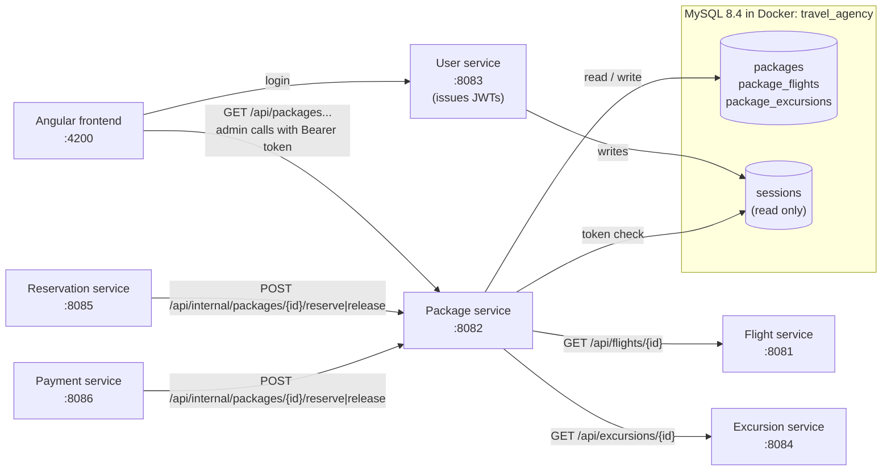

# Package service

The Package service manages the **travel packages** of the Online Travel Agency: a package is a
named trip (destination, number of nights, price, optional discount, dates) that **includes**
flights and excursions. The service lists and filters packages for the Angular frontend, lets an
administrator create, edit and compose them, and answers the availability checks of the
Reservation and Payment services. It listens on port **8082** and owns three tables of the shared
`travel_agency` MySQL database: `packages`, `package_flights` and `package_excursions`.

## Table of contents

1. [Architecture](#1-architecture)
2. [Tech stack](#2-tech-stack)
3. [Project structure](#3-project-structure)
4. [Prerequisites](#4-prerequisites)
5. [Start the shared database](#5-start-the-shared-database)
6. [Run option A: locally with Maven](#6-run-option-a-locally-with-maven)
7. [Run option B: with Docker](#7-run-option-b-with-docker)
8. [Mocks of the other catalogue services](#8-mocks-of-the-other-catalogue-services)
9. [Configuration](#9-configuration)
10. [Authentication](#10-authentication)
11. [API reference](#11-api-reference)
12. [Error codes](#12-error-codes)
13. [Business rules](#13-business-rules)
14. [Seed data](#14-seed-data)
15. [Tests](#15-tests)
16. [Troubleshooting](#16-troubleshooting)
17. [Team and ownership](#17-team-and-ownership)

---

## 1. Architecture



Ownership rule: this service stores only the **ids** of the flights and excursions of a package.
Their details (airline, seats, price...) always come from the Flight and Excursion services over
HTTP; the service never reads the `flights` or `excursions` tables.

## 2. Tech stack

| Component | Version / source |
|---|---|
| Java | 25 (`<java.version>` in `pom.xml`) |
| Spring Boot | 4.1.2 (parent of `pom.xml`): Web MVC, Data JPA (Hibernate), Validation |
| Database driver | `mysql-connector-j` (runtime), MySQL 8.4 server from the root `docker-compose.yml` |
| JWT | `com.auth0:java-jwt` 4.5.0 (HS256 verification) |
| HTTP client | Spring `RestClient` (no extra dependency) |
| Boilerplate | Lombok (entities only) |
| Tests | JUnit Jupiter 6.0.3, AssertJ, Mockito, Spring MockMvc, H2 (all from the Spring Boot test starters) |
| Build | Maven Wrapper (`mvnw`, Maven 3.10.0) |
| Docker images | build: `eclipse-temurin:25-jdk`, runtime: `eclipse-temurin:25-jre-alpine` |

## 3. Project structure

```
package-service/
├── src/main/java/com/travelagency/package_service/
│   ├── PackageServiceApplication.java  entry point (also registers the startup secrets check)
│   ├── controller/   REST endpoints only, no logic: PackageController (public),
│   │                 PackageAdminController (@RequireAdmin), InternalPackageController
│   ├── service/      business logic: PackageQueryService (list, detail), PackageCommandService
│   │                 (@Transactional DB writes), PackageAdminService (admin use cases),
│   │                 PackageAvailabilityService (availability, reserve, release),
│   │                 CompositionResolver (fetches flights/excursions of packages)
│   ├── repository/   Spring Data JPA repositories + PackageSpecifications (SQL filters)
│   ├── entity/       JPA mapping of the existing tables: TravelPackage, PackageFlight,
│   │                 PackageExcursion (+ composite ids), UserSession (read only)
│   ├── dto/          Java records for requests and responses (ApiResponse, PageResponse, ...)
│   ├── mapper/       PackageMapper (entity <-> JSON), PackageFormParser (admin form),
│   │                 PriceCalculator (promoPrice)
│   ├── client/       FlightClient, ExcursionClient (RestClient calls to the other services)
│   ├── security/     AuthService (JWT + session check), AuthInterceptor, @RequireAdmin, TokenHasher
│   ├── config/       AppProperties (app.*), WebConfig (CORS + interceptor),
│   │                 HttpClientConfig (timeouts), RequiredSecretsCheck
│   └── exception/    ErrorCode, ApiException, GlobalExceptionHandler (one JSON error format)
├── src/main/resources/application.properties   configuration, driven by environment variables
├── src/test/java/...                            unit and MockMvc tests (see section 15)
├── src/test/resources/application.properties   H2 test configuration (no Docker needed)
├── Dockerfile           multi-stage image (build with Maven, run on a JRE)
├── .dockerignore        keeps .env, target/ and IDE files out of the image
├── docker-compose.yml   runs this service only, attached to the shared MySQL network
├── .env.example         template of the local configuration (copy it to .env)
├── mvnw, mvnw.cmd, .mvn/  Maven Wrapper
└── pom.xml
```

## 4. Prerequisites

- **Docker Desktop**: always needed, because the database runs in Docker.
- **JDK 25**: only for run option A (Maven on your machine) and for the tests.
- **Python 3**: only to run the flight and excursion mocks (section 8).
- **Nothing else listening on port 3307.** The Docker MySQL is published on `127.0.0.1:3307`. If a
  local MySQL, WAMP or XAMPP also listens on that port, it answers instead of the container and you
  get `Access denied for user 'app_user'`. On Windows, stop it in `services.msc` or in the
  WAMP/XAMPP panel, and check with:

  ```powershell
  Get-NetTCPConnection -LocalPort 3307 -State Listen | Select-Object OwningProcess
  ```

## 5. Start the shared database

Both run modes use the MySQL container defined in the **repository root**.

```powershell
# at the repository root
copy .env.example .env          # first time only, then set the passwords
docker compose up -d            # MySQL 8.4 + phpMyAdmin
docker compose ps               # wait until travel_agency_mysql is "healthy"
```

- phpMyAdmin: <http://localhost:8080>
- MySQL from the host: `127.0.0.1:3307`, database `travel_agency`, user `app_user`, password
  `APP_DB_PASSWORD` of the root `.env`.

The scripts in `db/init/` run **only on the first start**, when the data volume is empty. They
create the database and the `app_user` account (`00-create-databases.sh`), the tables (`10-` to
`50-*.sql`) and the demo data (`90-seed.sql`, `95-seed-packages-extra.sql`). To start again from a
clean database:

```powershell
docker compose down -v          # deletes the volume, all data is lost
docker compose up -d            # re-runs every db/init script
```

`00-create-databases.sh` is executed by bash inside the Linux container, so it **must have LF line
endings**. If Git converted it to CRLF, bash fails on the `\r` characters, the database and the
`app_user` account are never created, and every service gets "Access denied" or "Unknown database".
Check it in Git Bash with `file db/init/00-create-databases.sh` (it must not say "CRLF").

## 6. Run option A: locally with Maven

Use this mode for development. The service runs on your machine and reaches MySQL on
`127.0.0.1:3307`.

```powershell
cd package-service
copy .env.example .env
# edit .env: DB_PASSWORD = APP_DB_PASSWORD of the root .env,
#            JWT_SECRET  = the same value as the user service
.\mvnw.cmd spring-boot:run
```

`.env` is read at startup through `spring.config.import=optional:file:.env[.properties]`. For this
mode keep `DB_HOST=127.0.0.1`, `DB_PORT=3307` and the `localhost` service URLs of `.env.example`.
The service is ready when the log shows `Started PackageServiceApplication`; try
`curl.exe http://localhost:8082/api/packages`.

Build a jar (runs the tests first) and start it:

```powershell
.\mvnw.cmd clean package
java -jar target\package_service-0.0.1-SNAPSHOT.jar
```

The service **refuses to start** if `JWT_SECRET` or `DB_PASSWORD` is empty (message
`Missing configuration [JWT_SECRET, DB_PASSWORD]`).

> **If `mvnw.cmd` says "Cannot start maven from wrapper"**: the Windows wrapper fails when the
> folder path contains an apostrophe (for example `Master d'excellence`). Use the POSIX wrapper
> through Git Bash instead, with the same arguments:
> `& "C:\Program Files\Git\bin\bash.exe" ./mvnw spring-boot:run`

## 7. Run option B: with Docker

```powershell
# at the repository root, after section 5
docker build -t package-service ./package-service                     # build the image only
docker compose -f package-service/docker-compose.yml up -d --build    # build + start
docker ps --filter name=travel_agency_package                         # wait for "(healthy)"
docker logs -f travel_agency_package                                  # follow the logs
docker compose -f package-service/docker-compose.yml down             # stop and remove
```

**Configuration.** The compose file reads `package-service/.env`, the same file as option A. The
secrets (`DB_PASSWORD`, `JWT_SECRET`) and `DB_NAME`, `DB_USER`, `CORS_ORIGINS`, `SERVICE_TIMEOUT`
come from it. The network addresses are different inside a container, so the compose file **sets
them itself** and ignores the host values of `.env`:

| Variable | Option A (host) | Option B (container) | Why |
|---|---|---|---|
| `DB_HOST` | `127.0.0.1` | `mysql` | in a container `127.0.0.1` is the container itself; MySQL is reached by its service name on the `travel_agency_net` network |
| `DB_PORT` | `3307` | `3306` | 3307 is the port published on the host; inside the network MySQL listens on 3306 |
| `FLIGHT_SERVICE_URL` | `http://localhost:8081` | `http://host.docker.internal:8081` | the flight service/mock runs on the host; `host.docker.internal` is the host seen from a container |
| `EXCURSION_SERVICE_URL` | `http://localhost:8084` | `http://host.docker.internal:8084` | same reason |

To point the container elsewhere (for example once the Flight service also runs in Docker), set
`DOCKER_FLIGHT_SERVICE_URL` / `DOCKER_EXCURSION_SERVICE_URL` in `.env`. If `DB_PASSWORD` or
`JWT_SECRET` is missing, `docker compose` stops with
`required variable DB_PASSWORD is missing a value`.

**What the Dockerfile does.**

- Multi-stage build. The first stage (`eclipse-temurin:25-jdk`) copies `mvnw`, `.mvn/` and
  `pom.xml`, downloads the dependencies in a cached layer, then compiles with
  `./mvnw -B clean package -DskipTests`. Tests run on the host, not in the image. CRLF line endings
  in `mvnw` are fixed with `sed`.
- The jar is split into Spring Boot layers (`jarmode=tools extract`) so that a code change only
  rebuilds the small application layer.
- The runtime stage is `eclipse-temurin:25-jre-alpine`. It runs as the non-root user `appuser`
  (uid 10001), with `JAVA_TOOL_OPTIONS=-XX:MaxRAMPercentage=75 -XX:+ExitOnOutOfMemoryError`.
- `HEALTHCHECK` calls `GET http://127.0.0.1:8082/api/packages?size=1` with `wget` every 15 s
  (60 s start period).
- No secret is in the image: `.env` is excluded by `.dockerignore`, and secrets are passed as
  environment variables at run time.
- The container joins the **external** network `travel_agency_net`, created by the root compose
  file, so start the database first.

**Do not run option A and option B at the same time**: both use port 8082.

## 8. Mocks of the other catalogue services

Until the real Flight (8081) and Excursion (8084) services run, start Kamal's mocks, each in its own
terminal, from the repository root:

```powershell
python kamal/mock/flight/index.py       # http://127.0.0.1:8081
python kamal/mock/excursion/index.py    # http://127.0.0.1:8084
```

Do **not** use `kamal/mock/run_all.py`: it also starts a fake package service on port 8082, which
conflicts with this service.

| Mock | Known ids |
|---|---|
| Flights | 1 RAM101 Casablanca-Paris, 2 RAM205 Casablanca-Marrakech, 3 AF1714 Paris-Istanbul, 4 TK1826 Marrakech-Istanbul |
| Excursions | 1 Marrakech medina tour, 2 Bosphorus boat cruise, 3 Agafay desert excursion |

They match the rows of `90-seed.sql`. The flights and excursions added by
`95-seed-packages-extra.sql` (ids 5+ and 4+) are unknown to the mocks, so packages 3 to 6 show an
empty composition while the mocks are used (see section 14).

## 9. Configuration

All values come from environment variables, or from `package-service/.env` in option A. Nothing
secret is hard-coded.

| Variable | Option A (local) | Option B (Docker) | Required | Meaning |
|---|---|---|---|---|
| `PORT` | `8082` | `8082` (fixed) | no | HTTP port (`server.port`) |
| `DB_HOST` | `127.0.0.1` | `mysql` (fixed) | no | MySQL host |
| `DB_PORT` | `3307` | `3306` (fixed) | no | MySQL port |
| `DB_NAME` | `travel_agency` | same | no | database name |
| `DB_USER` | `app_user` | same | no | MySQL account |
| `DB_PASSWORD` | `APP_DB_PASSWORD` of the root `.env` | same | **yes** | MySQL password; startup fails if empty |
| `JWT_SECRET` | same value as the user service | same | **yes** | HS256 secret used to verify tokens; startup fails if empty |
| `CORS_ORIGINS` | `http://localhost:4200` | same | no | comma-separated list of allowed origins |
| `FLIGHT_SERVICE_URL` | `http://localhost:8081` | `http://host.docker.internal:8081` | no | base URL of the Flight service |
| `EXCURSION_SERVICE_URL` | `http://localhost:8084` | `http://host.docker.internal:8084` | no | base URL of the Excursion service |
| `SERVICE_TIMEOUT` | `5` | same | no | connect and read timeout of those calls, in seconds |
| `DOCKER_FLIGHT_SERVICE_URL` | not used | optional | no | overrides `FLIGHT_SERVICE_URL` in Docker only |
| `DOCKER_EXCURSION_SERVICE_URL` | not used | optional | no | overrides `EXCURSION_SERVICE_URL` in Docker only |

Other settings in `application.properties`:

- **Database URL**: `jdbc:mysql://${DB_HOST}:${DB_PORT}/${DB_NAME}?useSSL=false&allowPublicKeyRetrieval=true&serverTimezone=UTC`,
  with Hibernate also working in UTC.
- **`spring.jpa.hibernate.ddl-auto=none`**: the schema belongs to `db/init/*.sql` and is shared by
  four services. Hibernate must never create, alter or drop a table. The entities only map the
  existing columns. `created_at` / `updated_at` are filled by MySQL.
- `spring.jpa.open-in-view=false` and `spring.jpa.show-sql=true` (SQL is printed in the log).
- **CORS** on `/api/**`: the origins of `CORS_ORIGINS`, methods `GET, POST, PUT, DELETE, OPTIONS`,
  headers `Content-Type, Authorization`, credentials allowed (the frontend uses
  `credentials: 'include'`), preflight cached 1 hour.
- **Timeouts**: each call to the Flight/Excursion service has a connect timeout and a read timeout
  of `SERVICE_TIMEOUT` seconds. If one call to a service fails, the rest of that service's items are
  skipped for the current request, so one service that is down costs at most one timeout.

## 10. Authentication

Admin endpoints need the header `Authorization: Bearer <token>`. Tokens are issued by the **User
service** (port 8083) at login. A token is accepted only if all of these are true:

1. It is an HS256 JWT signed with `JWT_SECRET`. **The secret must be identical in the user,
   reservation, payment and package services**, otherwise every token is rejected.
2. It is not expired (`exp` claim).
3. A row exists in the `sessions` table with `token_hash` = SHA-256 of the token (lowercase hex)
   and `expires_at` in the future (UTC). Logout deletes that row, so a logged-out token is refused
   even before it expires. This service only reads `sessions`.
4. The `role` claim is `ADMIN`. Otherwise the answer is 403 `FORBIDDEN`.

Claims used: `sub` (user id), `role` (`ADMIN` or `CLIENT`), `email`, `iat`, `exp`.

Get an admin token (the user service must be running on 8083 with the same `JWT_SECRET`) and reuse
it:

```powershell
$login = Invoke-RestMethod -Method Post -Uri "http://localhost:8083/api/auth/login" `
  -ContentType "application/json" `
  -Body '{"email":"admin@agency.travel","password":"Password123!"}'
$TOKEN = $login.data.jeton          # the user service returns the token in "jeton"
$H = @{ Authorization = "Bearer $TOKEN" }

Invoke-RestMethod -Uri "http://localhost:8082/api/packages" -Headers $H   # admin view of the list
```

| Endpoints | Access |
|---|---|
| `GET /api/packages`, `GET /api/packages/{id}`, `GET /api/packages/{id}/availability` | public. A valid ADMIN token on the list also returns inactive packages. An invalid token on a public endpoint is simply ignored. |
| `POST`, `PUT`, `DELETE` on `/api/packages/**` | ADMIN token required |
| `/api/internal/packages/**` | no user token (service-to-service calls) |

## 11. API reference

Base URL: `http://localhost:8082`. All bodies are JSON (`Content-Type: application/json`).

### 11.1 Envelopes

Success:

```json
{ "data": <payload> }
```

Error (every error, including validation, bad JSON, wrong types and unknown routes):

```json
{ "error": { "code": "ITEM_NOT_FOUND", "message": "Package not found.", "details": { "id": 999 } } }
```

Paginated list (`page` starts at 1):

```json
{ "data": { "data": [ ... ], "page": 1, "size": 20, "total": 7, "totalPages": 1 } }
```

`Invoke-RestMethod` throws on 4xx/5xx answers, and Windows PowerShell 5.1 does not always expose the
error body. Define this helper once per session to print it (works in 5.1 and 7):

```powershell
function Get-ApiError($err) {
  if ($err.ErrorDetails.Message) { return $err.ErrorDetails.Message }
  $stream = $err.Exception.Response.GetResponseStream(); $stream.Position = 0
  (New-Object System.IO.StreamReader($stream)).ReadToEnd()
}

try { Invoke-RestMethod -Uri "http://localhost:8082/api/packages/999" } catch { Get-ApiError $_ }
# {"error":{"code":"ITEM_NOT_FOUND","message":"Package not found.","details":{"id":999}}}
```

For GET requests, `curl.exe` prints error bodies directly.

### 11.2 Endpoints

| Method | Path | Access | Description |
|---|---|---|---|
| GET | `/api/packages` | public (admin sees inactive) | paginated, filtered list |
| GET | `/api/packages/{id}` | public | one package with its full composition |
| GET | `/api/packages/{id}/availability` | public | availability and seats left |
| POST | `/api/packages` | admin | create a package |
| POST or PUT | `/api/packages/{id}` | admin | update a package (the frontend uses POST) |
| DELETE | `/api/packages/{id}` | admin | delete a package and its composition |
| POST | `/api/packages/{id}/flights` | admin | add a flight to the package |
| DELETE | `/api/packages/{id}/flights/{flightId}` | admin | remove a flight from the package |
| POST | `/api/packages/{id}/excursions` | admin | add an excursion to the package |
| DELETE | `/api/packages/{id}/excursions/{excursionId}` | admin | remove an excursion from the package |
| POST | `/api/internal/packages/{id}/reserve` | internal | check that a quantity can be reserved |
| POST | `/api/internal/packages/{id}/release` | internal | acknowledge a release |

### 11.3 The Package object

Same shape as the frontend model `KzPackage` (`frontend/src/models/kz_package.interface.ts`), plus
`active`:

| Field | Type | Meaning |
|---|---|---|
| `id` | number | package id |
| `name` | string | name (max 120) |
| `description` | string | free text, `""` when empty |
| `destination` | string | destination (max 120) |
| `durationNights` | number | number of nights (1 or more) |
| `price` | number, 2 decimals | base price |
| `startDate`, `endDate` | string `YYYY-MM-DD` | sale period, `""` when not set |
| `discountPercentage` | number, 2 decimals | 0 to 100 |
| `promoPrice` | number, 2 decimals | `price * (100 - discountPercentage) / 100`, rounded HALF_UP |
| `imageUrl` | string | image path, `""` when empty |
| `available` | boolean | equal to `active` in this object (expiry is checked by `/availability`) |
| `active` | boolean | the admin switch; inactive packages are hidden from the public list |
| `composition.flights` | array | flights as returned by the Flight service, plus `position` |
| `composition.excursions` | array | excursions as returned by the Excursion service, plus `position` |

Money is serialized with two decimals (`2400.00`). Composition items are copied as-is from the
other services and get an extra `position` key (order inside the package). An item that cannot be
fetched (service down, or 404) is left out, and the package is still returned.

### 11.4 `GET /api/packages`

Query parameters, all optional:

| Parameter | Type | Rule |
|---|---|---|
| `search` | text | name **or** destination contains it, case-insensitive |
| `destination` | text | destination contains it, case-insensitive |
| `startDate` | `YYYY`, `YYYY-MM` or `YYYY-MM-DD` | prefix match on the start date (`2027-03` = any start in March 2027) |
| `minPrice`, `maxPrice` | number | compared to `promoPrice`, not to `price` |
| `page` | integer, default 1 | 1 or more |
| `size` | integer, default 20 | 1 or more; values above 100 are reduced to 100 |
| `withComposition` | boolean, default `false` | also fetch the flights/excursions (each distinct item fetched once per request) |

Only active packages are returned, unless the request carries a valid ADMIN token. Results are
ordered by `id`. All filters run in SQL.

```powershell
curl.exe "http://localhost:8082/api/packages?size=2"
curl.exe "http://localhost:8082/api/packages?search=marrakech&maxPrice=2500"
curl.exe "http://localhost:8082/api/packages?destination=fes&startDate=2027-05&withComposition=true"
```

Response of `?size=2` on the seed data (shortened to the first item):

```json
{
  "data": {
    "data": [
      {
        "id": 1,
        "name": "Marrakech escape",
        "description": "3 nights, full board and a visit of the medina.",
        "destination": "Marrakech",
        "durationNights": 3,
        "price": 2400.00,
        "startDate": "2026-06-01",
        "endDate": "2026-09-30",
        "discountPercentage": 10.00,
        "promoPrice": 2160.00,
        "imageUrl": "imgs/palace/ancient-palace-01.jpeg",
        "available": true,
        "active": true,
        "composition": { "flights": [], "excursions": [] }
      }
    ],
    "page": 1,
    "size": 2,
    "total": 7,
    "totalPages": 4
  }
}
```

Errors: 400 `INVALID_FORMAT` for a bad `startDate`, `page`/`size` below 1, or a non-numeric
`minPrice`/`maxPrice`:

```json
{"error":{"code":"INVALID_FORMAT","message":"Invalid query parameter: startDate.","details":{"startDate":"Use YYYY, YYYY-MM or YYYY-MM-DD."}}}
```

### 11.5 `GET /api/packages/{id}`

Returns one package with its **full composition**, even if it is inactive.

```powershell
curl.exe http://localhost:8082/api/packages/7
```

Response (with the flight and excursion mocks running; fields of the second excursion shortened):

```json
{
  "data": {
    "id": 7,
    "name": "Marrakech winter escape",
    "description": "4 nights in a riad, medina tour and desert dinner.",
    "destination": "Marrakech",
    "durationNights": 4,
    "price": 3200.00,
    "startDate": "2026-12-15",
    "endDate": "2027-03-31",
    "discountPercentage": 20.00,
    "promoPrice": 2560.00,
    "imageUrl": "imgs/sahara/camp-berber-tent.png",
    "available": true,
    "active": true,
    "composition": {
      "flights": [
        {
          "id": 2, "airline": "Royal Air Maroc", "flightNumber": "RAM205",
          "departureCity": "Casablanca", "arrivalCity": "Marrakech",
          "departureTime": "2026-06-05T07:30:00Z", "arrivalTime": "2026-06-05T08:30:00Z",
          "availableSeats": 60, "totalSeats": 150, "price": 890.0,
          "imageUrl": "imgs/palace/ancient-palace-03.jpeg", "active": true,
          "position": 1
        }
      ],
      "excursions": [
        {
          "id": 1, "title": "Marrakech medina tour", "location": "Marrakech",
          "description": "Guided tour of the medina and the souks.",
          "date": "2026-06-06", "startTime": "09:00:00", "dureeMinutes": 180,
          "capacity": 30, "availableSeats": 12, "price": 120.0, "guide": "Youssef",
          "imageUrl": "imgs/sahara/market-berber-rugs.jpeg", "available": true,
          "position": 1
        },
        { "id": 3, "title": "Agafay desert excursion", "availableSeats": 25, "position": 2 }
      ]
    }
  }
}
```

Errors: 404 `ITEM_NOT_FOUND` (`{"error":{"code":"ITEM_NOT_FOUND","message":"Package not found.","details":{"id":999}}}`),
400 `INVALID_FORMAT` when the id is not a number (`/api/packages/abc`).

### 11.6 `GET /api/packages/{id}/availability`

```powershell
curl.exe http://localhost:8082/api/packages/7/availability
```

```json
{"data":{"itemId":7,"available":true,"availableSeats":12}}
```

`availableSeats` is the smallest `availableSeats` among the flights and excursions of the package,
or `null` when the package has no composition or none of its items could be fetched. See section 13
for `available`. Errors: 404 `ITEM_NOT_FOUND`.

### 11.7 `POST /api/packages` (admin)

Body (frontend `KzPackageForm`). The admin form sends **every value as a string**
(`"durationNights": "3"`, `"discountPercentage": ""`). Strings and JSON numbers/booleans are both
accepted. An empty string means "no value".

| Field | Required | Rule |
|---|---|---|
| `name` | yes | text, max 120 characters (trimmed) |
| `destination` | yes | text, max 120 |
| `description` | no | text |
| `imageUrl` | no | text, max 255 |
| `durationNights` | yes | whole number from 1 to 65535 |
| `price` | yes | number from 0 to 99999999.99, at most 2 decimals |
| `discountPercentage` | no, default 0 | number from 0 to 100, at most 2 decimals |
| `startDate`, `endDate` | no | `YYYY-MM-DD`; if both are set, `endDate` must be on or after `startDate` |
| `active` | no, default `true` | `true`/`false` (also `"true"`, `"false"`, `"1"`, `"0"`) |

```powershell
$form = '{"name":"Sahara dream","description":"4 nights in the desert","destination":"Merzouga","durationNights":"4","price":"3000","startDate":"2027-03-01","endDate":"2027-05-31","discountPercentage":"10","imageUrl":"","active":true}'
$created = Invoke-RestMethod -Method Post -Uri "http://localhost:8082/api/packages" -Headers $H -ContentType "application/json" -Body $form
$ID = $created.data.id
```

Response: **201 Created**, `{ "data": <Package> }` with an empty composition (`promoPrice` 2700.00
for this example).

Errors:
- 400 `MISSING_FIELD` when a required field is empty; every field error is listed together:
  `{"error":{"code":"MISSING_FIELD","message":"Required fields are missing.","details":{"name":"This field is required.","price":"This field is required."}}}`
- 400 `INVALID_FORMAT` for a wrong format or range, for example `{"details":{"discountPercentage":"Must be between 0 and 100."}}`.
  If a field is missing and another is invalid, the code is `MISSING_FIELD` and both are listed.
- 400 `INVALID_FORMAT` for a body that is not valid JSON.
- 422 `BUSINESS_RULE_VIOLATION` when `endDate` is before `startDate` (`details.endDate`).
- 401 / 403, see section 10.

### 11.8 `POST /api/packages/{id}` or `PUT /api/packages/{id}` (admin)

Same body and rules as create. The update **replaces every field**: send the full form, as the
admin page does (an omitted optional field becomes empty or takes its default).

```powershell
Invoke-RestMethod -Method Post -Uri "http://localhost:8082/api/packages/$ID" -Headers $H -ContentType "application/json" -Body $form
Invoke-RestMethod -Method Put  -Uri "http://localhost:8082/api/packages/$ID" -Headers $H -ContentType "application/json" -Body $form
```

Response: **200**, `{ "data": <Package> }` with its composition. Errors: same as create, plus 404
`ITEM_NOT_FOUND`.

### 11.9 `DELETE /api/packages/{id}` (admin)

```powershell
Invoke-RestMethod -Method Delete -Uri "http://localhost:8082/api/packages/$ID" -Headers $H
```

```json
{"data":{"deleted":true,"id":9}}
```

The composition rows are deleted too. Errors: 404 `ITEM_NOT_FOUND`, 401 / 403.

### 11.10 Composition (admin)

| Request | Body |
|---|---|
| `POST /api/packages/{id}/flights` | `{ "flightId": 2, "position": 1 }` |
| `POST /api/packages/{id}/excursions` | `{ "excursionId": 1, "position": 1 }` |
| `DELETE /api/packages/{id}/flights/{flightId}` | none |
| `DELETE /api/packages/{id}/excursions/{excursionId}` | none |

- `flightId` / `excursionId`: required, positive integer (a numeric string is accepted).
- `position`: optional, positive integer. When omitted, the item is placed after the last one.
- Before linking, the service calls the Flight/Excursion service to check that the item exists.

```powershell
Invoke-RestMethod -Method Post -Uri "http://localhost:8082/api/packages/$ID/flights" -Headers $H -ContentType "application/json" -Body '{"flightId":2,"position":1}'
Invoke-RestMethod -Method Post -Uri "http://localhost:8082/api/packages/$ID/excursions" -Headers $H -ContentType "application/json" -Body '{"excursionId":1}'
Invoke-RestMethod -Method Delete -Uri "http://localhost:8082/api/packages/$ID/flights/2" -Headers $H
Invoke-RestMethod -Method Delete -Uri "http://localhost:8082/api/packages/$ID/excursions/1" -Headers $H
```

Response: **200**, `{ "data": <Package> }` with the updated composition.

Errors:
- 404 `ITEM_NOT_FOUND`: unknown package; flight/excursion unknown to its service (or rejected by the
  database foreign key), e.g. `{"details":{"flightId":42}}`; removing an item that is not linked.
- 409 `DUPLICATE`: the item is already part of the package.
- 400 `MISSING_FIELD` / `INVALID_FORMAT`: missing or non-positive `flightId` / `excursionId` / `position`.
- 502 `SERVICE_UNAVAILABLE`: the Flight/Excursion service cannot be reached, so the item cannot be checked.
- 401 / 403.

### 11.11 `POST /api/internal/packages/{id}/reserve` (internal)

Called by the Reservation and Payment services (`kamal/*/helpers/catalog.py`). No user token.

Body: `quantity` (required, positive integer) and `reservationId` (any value, echoed back).

```powershell
Invoke-RestMethod -Method Post -Uri "http://localhost:8082/api/internal/packages/7/reserve" -ContentType "application/json" -Body '{"quantity":2,"reservationId":"123"}'
```

```json
{"data":{"itemId":7,"quantity":2,"reservationId":"123","reserved":true}}
```

Errors:
- 404 `ITEM_NOT_FOUND`: unknown package.
- 409 `INSUFFICIENT_AVAILABILITY`: the package is not available, or `quantity` is greater than the
  seats left:
  `{"error":{"code":"INSUFFICIENT_AVAILABILITY","message":"Not enough availability.","details":{"itemId":7,"requested":20,"available":12}}}`
  For an inactive or expired package the message is `This package is not available.` and
  `available` is 0.
- 400 `MISSING_FIELD` (no `quantity`) / `INVALID_FORMAT` (quantity 0, negative, or not a number).

Nothing is written to the database (see section 13).

### 11.12 `POST /api/internal/packages/{id}/release` (internal)

Same body as reserve.

```powershell
Invoke-RestMethod -Method Post -Uri "http://localhost:8082/api/internal/packages/7/release" -ContentType "application/json" -Body '{"quantity":2,"reservationId":"123"}'
```

```json
{"data":{"itemId":7,"quantity":2,"reservationId":"123","released":true}}
```

Errors: 404 `ITEM_NOT_FOUND`, 400 for an invalid `quantity`.

## 12. Error codes

| Code | HTTP | When |
|---|---|---|
| `MISSING_FIELD` | 400 | a required body field or parameter is missing or empty |
| `INVALID_FORMAT` | 400 | wrong type, format or range; body is not valid JSON; bad query parameter or path id |
| `INVALID_FORMAT` | 405 | HTTP method not supported on the route (e.g. `PATCH`) |
| `INVALID_FORMAT` | 415 | `Content-Type` is not `application/json` |
| `UNAUTHENTICATED` | 401 | no token, malformed or badly signed token, or no open session for it |
| `TOKEN_EXPIRED` | 401 | the token's `exp` is in the past |
| `FORBIDDEN` | 403 | valid token but the role is not `ADMIN` |
| `ITEM_NOT_FOUND` | 404 | unknown package, flight, excursion or composition link; also unknown routes (`Route not found.`) |
| `DUPLICATE` | 409 | the flight/excursion is already part of the package |
| `INSUFFICIENT_AVAILABILITY` | 409 | reserve on an unavailable package or for too many seats |
| `BUSINESS_RULE_VIOLATION` | 422 | `endDate` before `startDate`; any other database constraint violation |
| `SERVICE_UNAVAILABLE` | 502 | the Flight/Excursion service is unreachable while linking an item |
| `INTERNAL_ERROR` | 500 | unexpected error (details in the service log) |

## 13. Business rules

- **promoPrice** = `price * (100 - discountPercentage) / 100`, rounded **HALF_UP** to 2 decimals.
  Example: 2400.00 at 10% gives 2160.00; 99.99 at 12.5% gives 87.49. The `minPrice`/`maxPrice`
  filters use this value, computed in SQL with the same rounding.
- **availableSeats** = the minimum `availableSeats` across the package's flights and excursions
  (fetched from their services), or `null` if unknown.
- **available** (availability endpoint and reserve) = `active` AND (`endDate` is empty OR
  `endDate` is today or later) AND (`availableSeats` is `null` OR greater than 0). "Today" is the
  server's date; the Docker container runs in UTC.
- **Inactive packages** (`active = false`) are hidden from the public list but returned by
  `GET /api/packages/{id}` and in the admin list. They cannot be reserved.
- **Expired packages** (`endDate` in the past) still appear in the list with `available: true`,
  because the `available` field of the Package object only reflects `active`. The
  `/availability` endpoint and `reserve` report them as not available.
- **Validation**: `durationNights` 1 or more; `price` 0 or more; `discountPercentage` 0 to 100
  (default 0); at most 2 decimals for money; if both dates are set, `endDate` must be on or after
  `startDate` (422 otherwise). The database enforces the same rules with CHECK constraints.
- **Reserve / release**: a package has **no stock of its own** (no column for it). Seats belong
  to the flights and excursions, and the Reservation service reserves them directly with those
  services. `reserve` only checks that the requested quantity fits (409 otherwise); `release`
  only checks that the package exists. Neither writes to the database.

## 14. Seed data

After a fresh database (`docker compose down -v` then `up -d`), these packages exist:

| id | Name | Destination | Dates | Price / discount / promo | Active | Composition (flights; excursions) | Source |
|---|---|---|---|---|---|---|---|
| 1 | Marrakech escape | Marrakech | 2026-06-01 to 2026-09-30 | 2400.00 / 10% / 2160.00 | yes | RAM205; medina tour, Agafay desert | `90-seed.sql` |
| 2 | Istanbul wonders | Istanbul | 2026-06-15 to 2026-10-15 | 6200.00 / 0% / 6200.00 | yes | AF1714, TK1826; Bosphorus cruise | `90-seed.sql` |
| 3 | Agadir sun and surf | Agadir | 2027-03-14 to 2027-06-30 | 4500.00 / 15% / 3825.00 | yes | RAM310; Taghazout surf lesson | `95-seed-packages-extra.sql` |
| 4 | Cairo and the pyramids | Cairo | 2027-04-10 to 2027-08-31 | 8900.00 / 5% / 8455.00 | yes | MS848; Giza pyramids tour | `95-...` |
| 5 | Cappadocia balloons | Cappadocia | 2027-04-18 to 2027-10-15 | 7400.00 / 0% / 7400.00 | yes | TK2008; Cappadocia balloon flight | `95-...` |
| 6 | Fes imperial city | Fes | 2027-05-02 to 2027-09-30 | 2900.00 / 10% / 2610.00 | yes | RAM450; Fes medina and tanneries | `95-...` |
| 7 | Marrakech winter escape | Marrakech | 2026-12-15 to 2027-03-31 | 3200.00 / 20% / 2560.00 | yes | RAM205; medina tour, Agafay desert | `95-...` |
| 8 | Chefchaouen blue city (archived) | Chefchaouen | 2027-02-01 to 2027-04-30 | 1800.00 / 0% / 1800.00 | **no** | none | `95-...` |

- Packages 1 and 2 are dated 2026, so they are already expired: listed, but `/availability`
  returns `available: false`.
- `95-seed-packages-extra.sql` also adds the flights RAM310, MS848, TK2008, RAM450 and four
  excursions. It is idempotent: on an existing database you can run it again without duplicates:

  ```powershell
  Get-Content db/init/95-seed-packages-extra.sql | docker exec -i travel_agency_mysql sh -c 'mysql -uroot -p"$MYSQL_ROOT_PASSWORD"'
  ```

- With the mocks (section 8), only packages 1, 2 and 7 show a full composition.

## 15. Tests

The tests use an in-memory **H2** database in MySQL mode (`src/test/resources/application.properties`,
`ddl-auto=create-drop`, a test JWT secret) and mock the Flight/Excursion clients with
`@MockitoBean`. They need **no Docker, no MySQL, no `.env` and no other service**. Each test
starts from empty tables.

```powershell
cd package-service
.\mvnw.cmd clean test                                                 # all tests
.\mvnw.cmd test -Dtest=PackageAdminApiTest                            # one class
.\mvnw.cmd test "-Dtest=PackageAdminApiTest#create_validForm_created" # one method
```

(If `mvnw.cmd` fails because of an apostrophe in the path, see the note in section 6.)

| Test class | Type | What it covers | Tests |
|---|---|---|---|
| `mapper/PriceCalculatorTest` | unit | promoPrice formula and HALF_UP rounding, null values, 2-decimal money | 13 |
| `mapper/PackageFormParserTest` | unit | strings and numbers accepted, `""` as empty, defaults, MISSING_FIELD vs INVALID_FORMAT, lengths, real calendar dates, end before start (422) | 53 |
| `security/TokenHasherTest` | unit | SHA-256 lowercase hex against known digests | 4 |
| `service/PackageCommandServiceTest` | unit (Mockito) | create/update/delete, delete order, link position given or appended, DUPLICATE, FK violation to ITEM_NOT_FOUND, unlink | 16 |
| `service/PackageAvailabilityServiceTest` | unit (Mockito) | minimum seats, endDate boundary, inactive/sold out, reserve details, release | 13 |
| `service/CompositionResolverTest` | unit (Mockito) | order and position, shared item fetched once, service down (skipped, no more calls), 404 skipped | 6 |
| `api/PackageQueryApiTest` | MockMvc | list (admin visibility for 7 token kinds, 13 filter cases, pagination, invalid parameters, composition on demand), detail, availability, CORS | 42 |
| `api/PackageAdminApiTest` | MockMvc | auth matrix (401 / TOKEN_EXPIRED / 403), create, validation, 422, update via POST and PUT, delete, flights/excursions composition, 502 | 27 |
| `api/InternalPackageApiTest` | MockMvc | reserve 200 / 404 / 409 (seats, inactive, expired), quantity validation, release | 12 |
| `PackageServiceApplicationTests` | context | the Spring context starts | 1 |
| **Total** | | | **187** |

`api/ApiTestSupport` is the shared base class of the MockMvc tests (token and data helpers).

## 16. Troubleshooting

| Symptom | Cause and fix |
|---|---|
| `Access denied for user 'app_user'` | Another MySQL (local service, WAMP, XAMPP) listens on 3307 and answers instead of Docker: stop it (section 4). Otherwise `DB_PASSWORD` differs from `APP_DB_PASSWORD` of the root `.env`, or the account was never created (see the CRLF line below). |
| `Communications link failure` | MySQL is not running or not healthy yet (`docker compose ps`), or the host/port is wrong: `127.0.0.1:3307` for option A, `mysql:3306` inside Docker. |
| `Unknown database 'travel_agency'` or no tables | The init scripts did not run: `00-create-databases.sh` has CRLF line endings, or the volume already existed. Fix the line endings, then `docker compose down -v` and `docker compose up -d`. |
| `network travel_agency_net declared as external, but could not be found` | Start the root compose first: `docker compose up -d` at the repository root. |
| Container `unhealthy` or restarting | `docker logs travel_agency_package`. Look for `Missing configuration`, a database error, or an exception at startup. Compose refuses to start at all when `JWT_SECRET` or `DB_PASSWORD` is missing from `package-service/.env`. |
| `Missing configuration [JWT_SECRET, ...]` at startup | Set the variable in `package-service/.env` (option A) or the environment. |
| `Port 8082 was already in use` | The other run mode is still running, or `kamal/mock/run_all.py` (fake package service) is running. Find it with `Get-NetTCPConnection -LocalPort 8082 -State Listen`, then stop it or `docker compose -f package-service/docker-compose.yml down`. |
| `mvnw.cmd`: `Cannot start maven from wrapper` | Apostrophe in the folder path: use `& "C:\Program Files\Git\bin\bash.exe" ./mvnw ...` (section 6). |
| Empty `composition`, `availableSeats: null` | The Flight/Excursion services or mocks are not running, or do not know these ids. The log shows `service unavailable, ... skipped` or `not found ... skipped`. In Docker, they must be reachable at `host.docker.internal`. |
| 401 `UNAUTHENTICATED` on admin calls | No `Authorization: Bearer` header, a malformed token, a token signed with a different `JWT_SECRET`, or a session that was closed (logout) or expired in `sessions`. |
| 401 `TOKEN_EXPIRED` | Log in again to get a new token. |
| 403 `FORBIDDEN` | The token belongs to a `CLIENT`; log in as `admin@agency.travel`. |
| Inactive packages missing in the admin table | The list call was made without a valid ADMIN token (an invalid token is ignored on public endpoints). |

## 17. Team and ownership

| Service | Port | Owner | Branch |
|---|---|---|---|
| **Package service (this one)** | 8082 | **Youssef** | `youssef` (current work on `package-service`) |
| Flight service | 8081 | Mohammed | `mohammed` |
| Excursion service | 8084 | Marwan | `marwan` |
| User service (auth, profile) | 8083 | Kamal | `kamal` |
| Reservation service | 8085 | Kamal | `kamal` |
| Payment service | 8086 | Kamal | `kamal` |
| Angular frontend | 4200 | team | |
| MySQL + phpMyAdmin (root `docker-compose.yml`) | 3307 / 8080 | shared | |

Table ownership in `travel_agency`: this service reads and writes `packages`, `package_flights`
and `package_excursions`, and only **reads** `sessions` (owned by Kamal).
